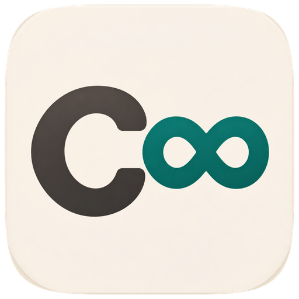

<p align="center"></p>

# Continuum 93 — native C++ / SDL3 edition

A native port of **[Continuum 93](https://github.com/EnthusiastGuy/Continuum-93)**, the fantasy retro computer
(16 MB of RAM, a 24-bit address space, 8 video layers of 480×270 with 256 colours each, and its own
assembler, BASIC and C compilers, OS and debugger). The original is written in C# on .NET 8 and MonoGame;
this edition rewrites it in **C++20 on SDL3**. It ships as **one statically linked executable** that runs the
same programs with the same results, several times faster.

The reference implementation is the source of truth. Every guest-visible behaviour was ported from it and
checked against it by an automated oracle, quirks included. The few places where the port deliberately
differs are listed under [Deliberate differences](#deliberate-differences).

---

## Why a native port

| | MonoGame original | This port |
|---|---|---|
| What you ship | 26 files + the .NET runtime (~19 MB) | `continuum.exe` (~5.8 MB) + `Data/` |
| Dependencies at run time | .NET 8, MonoGame DesktopGL, SDL2, OpenAL | none (SDL3, Ogg and Opus are linked in, static C runtime) |
| Simple instructions per second | ~104 M | ~786 M (MSVC), ~922 M (GCC 15) on a Ryzen 9 9950X3D |
| `CPU benchmark` program | self-calibrated "MHz" | ~800 MHz, as the clock an i486-class CPU would need to keep up ([D-17](docs/DECISIONS.md)) |
| Layer compositing | CPU, every frame | GPU (indexed textures, one palette per layer), CPU fallback |
| Start-up | JIT warm-up | instant; Q OS assembles in ~2 ms |

**Same machine, same results.** All CPU instructions, interrupts, the assembler, the BASIC and C
compilers, the XSound synthesizer and the service-mode tools produce byte-identical output to the
reference (see [Testing](#testing)).

**Faster without changing the machine.** The interpreter keeps the instruction pointer in a host register.
It dispatches each instruction through one fused table on its first two bytes, and handlers jump straight
to the next handler (threaded code). Memory is always accessed byte by byte and big-endian, so the speed
does not depend on host endianness or alignment.

**The GPU is optional.** Each video layer is an 8-bit indexed texture with its own palette, so the GPU does
palette lookup, transparency and scaling. Without a usable GPU renderer, a CPU compositor produces the
same picture. The log says which path is active.

---

## Platforms

| Platform | Status |
|---|---|
| Windows 10/11 x64 | Built and verified (MSVC, `build.cmd`) |
| Linux x64 / arm64 | Portable code; the CPU core builds warning-free with GCC 15. A full SDL build has not been verified yet |
| macOS (Apple silicon / Intel) | Portable code; not built yet |
| Raspberry Pi (64-bit OS) | Same as Linux arm64; not tested yet |

The code is portable C++20 plus SDL3. OS-specific code exists only behind guarded `#if` blocks. There are no
compiler intrinsics without a portable fallback, and no assumptions about endianness. On GCC and Clang,
floating-point contraction is disabled (`-ffp-contract=off`) so float results match .NET bit for bit on
every CPU.

---

## Building

You need CMake ≥ 3.24, Ninja (or Make), and a C++20 compiler. SDL3, libogg and libopus are fetched and
built statically by CMake on the first build (internet access needed once).

**Windows** (Visual Studio 2022 or Build Tools, with the "Desktop development with C++" workload):

```bat
build.cmd            :: Release -> build\release\continuum.exe
build.cmd debug      :: Debug, with a console showing the log
```

`build.cmd` finds Visual Studio with `vswhere` and uses the CMake and Ninja that come with it.

**Linux / macOS:**

```sh
./build.sh           # Release -> build/release/continuum
./build.sh debug
```

On Linux, install SDL3's build dependencies first (X11/Wayland, ALSA/PulseAudio/PipeWire headers; see
the [SDL3 Linux README](https://wiki.libsdl.org/SDL3/README-linux)).

A build copies `Data/` next to the executable. The executable and `Data/` are all you need to distribute.

---

## Running

Start `continuum`. By default it boots the dual-boot selector (`Data/os/boot/boot.c`), which offers the
**Halcyon** desktop (written in C) or **Q OS** (written in assembly). Settings are in `Data/init.cfg`:

| Setting | Meaning |
|---|---|
| `bootProgram` | The `.asm` or `.c` file assembled or compiled and run at power-on |
| `fullscreen` | Start in fullscreen |
| `disableMouse` | Turn off the guest mouse API |

The window can be resized freely; the 480×270 picture is scaled and letterboxed.

**Command line:** `continuum -help` lists the options; on Windows, redirect it to see it
(`continuum -help > help.txt`). `continuum -png2font <file.png>` converts an image into a Continuum
font, as in the original.

**Service mode (debugger):** press **F1**. It is a faithful recreation of the original's tool windows:
disassembler, registers, flags, memory, memory map, stacks, float registers, palettes, 3D view, watcher
and immediate window.

| Key | Action |
|---|---|
| F1 | Enter or leave service mode (leaving resumes the machine) |
| F5 | Toggle step-by-step |
| F8 | Continue |
| F9 | Step one instruction |
| F10 | Refresh the disassembly |

**Logs:** written to `%LOCALAPPDATA%\Continuum 93\logs\` on Windows,
`~/Library/Application Support/Continuum 93/logs/` on macOS, and `~/.local/state/continuum93/logs/`
on Linux. Every line has the form `Subsystem: what happened; consequence`
([docs/LOGGING.md](docs/LOGGING.md)).

---

## Architecture

```
src/
  main.cpp            window, event loop, settings, boot (main thread)
  machine.h           all machine state; inline, big-endian, 24-bit-masked accessors
  cpu.cpp, ops_*.inc  interpreter: fused dispatch table, one templated handler per instruction family
  ints*.cpp           interrupts: machine, video and drawing, text, file system, input
  video.*             presenter: GPU indexed layers or CPU compositor
  audio*.cpp          audio processor: XSound synthesizer (bit-exact), PLAY, WAV and Ogg Opus streams
  asm.cpp             assembler
  basic.cpp           BASIC compiler
  cc_*.cpp            C compiler (preprocessor, parser, code generator, runtime library)
  service/            service mode: window framework plus one file per tool window
  tools.cpp           command-line tools (-help, -png2font)
  log.*               rotating log
tests/
  oracle/             C# program that drives the original emulator to produce reference results
  conformance.cpp     replays those results through the C++ code and reports every difference
docs/                 plan, progress, decisions, logging and service-mode notes
Data/                 guest content: operating systems, programs, fonts, themes
```

**Threads.**
- The main thread handles SDL events and input, and presents frames at vsync.
- The CPU thread runs the machine flat out, like the original's machine thread.
- SDL's audio thread pulls samples.

They share plain memory and a few atomics. Pending events (input callbacks, stop requests, debugger
breaks) are bits in one word that the CPU checks once per instruction.

**Service mode costs nothing until you open it.** Memory-activity tracking and the watcher run in a
separate, instrumented copy of the CPU loop. The machine switches to that copy only while service mode is
open, so the normal loop has no debugger checks.

---

## Deliberate differences

Each difference is a recorded decision in [docs/DECISIONS.md](docs/DECISIONS.md). Notable ones:

- **The assembler rejects lines it cannot encode** (D-9). The original silently emitted a lone opcode byte.
  The four shipped programs that relied on this were fixed.
- **The BASIC compiler emits working code** (D-18). The original's string functions (UCASE, TRIM, INSTR,
  `+`, …) crashed the machine.
- **Guest programs cannot leave the file system root** (D-13). The original accepted paths like
  `..` and `C:\`. Build interrupts may read the rest of `Data/` (D-19).
- **Leaving service mode with F1 resumes the machine** (D-24). The original stayed paused.
- **The benchmark's MHz is a real-hardware equivalent** (D-17).
- **The window resizes freely and letterboxes** (D-22). The original forced 16:9.
- **No network debug server** (D-3).

---

## Testing

`tests/oracle` is a C# console program that references the original emulator and records what it does.
`tests/conformance.cpp` replays the same inputs through the port and compares the results:

| Suite | Coverage | Result |
|---|---|---|
| CPU instructions | every encodable variant, random operands, registers and memory | 1,072 variants, 103,487 cases, 0 wrong |
| Whole programs | `.asm` and `.c` programs run for N steps; registers, RAM and video compared | 44 / 44 |
| Assembler | every shipped `.asm` file and the test corpus, byte for byte | 132 identical, 5 expected differences (D-9) |
| BASIC compiler | 341 programs | 228 identical, 113 expected differences (D-18); 7 run-time tests pass |
| C compiler | 541 programs | 541 identical |
| Disassembler, watcher, immediate window | service-mode output | 27,148 · 32,476 · 65 (+14 D-9) identical |
| XSound | 137 sound definitions, 86,984,651 samples | 0 samples differ |

```bat
tests\conf.cmd                          :: CPU instruction vectors
tests\programs.cmd                      :: whole programs (regenerates the reference results)
build\release\conformance.exe --bench   :: interpreter speed on five instruction mixes
```

---

## Project documents

- [docs/PROGRESS.md](docs/PROGRESS.md): current state and next steps
- [docs/PLAN.md](docs/PLAN.md): goals, architecture, phases, benchmarks
- [docs/DECISIONS.md](docs/DECISIONS.md): every deliberate choice and deviation
- [docs/LOGGING.md](docs/LOGGING.md): log format and locations
- [docs/SERVICE.md](docs/SERVICE.md): service mode internals

For the machine itself (instruction set, interrupts, programming manuals) and its community, see the
[original project](https://github.com/EnthusiastGuy/Continuum-93) and its
[Discord](https://discord.gg/6AYkhnzxD9).

## License

MIT, see [LICENSE](LICENSE).
